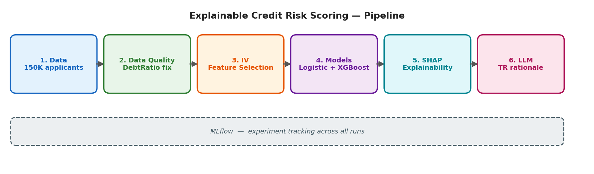
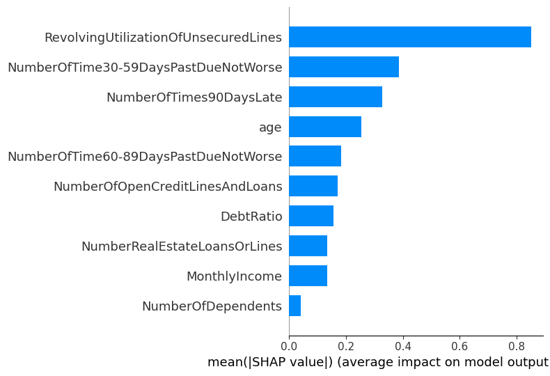
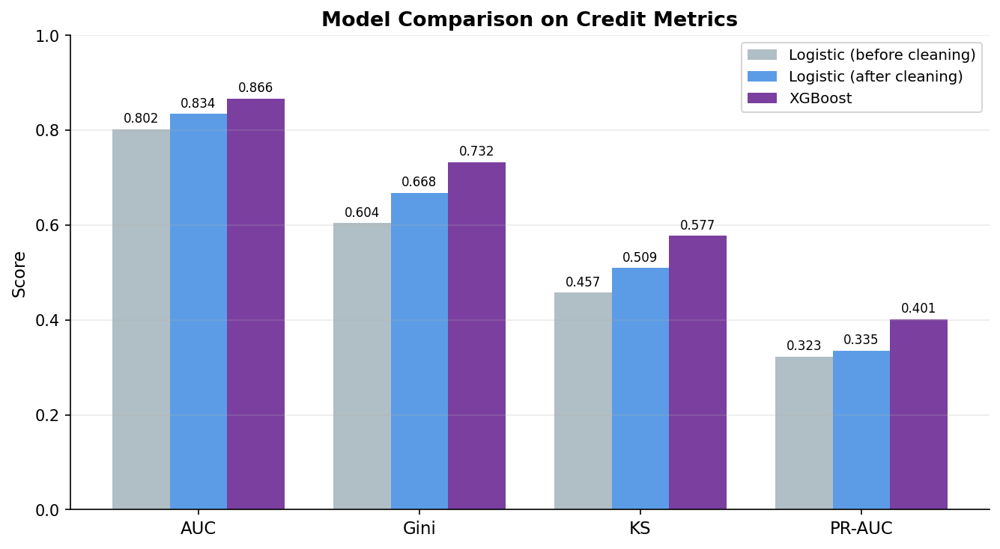
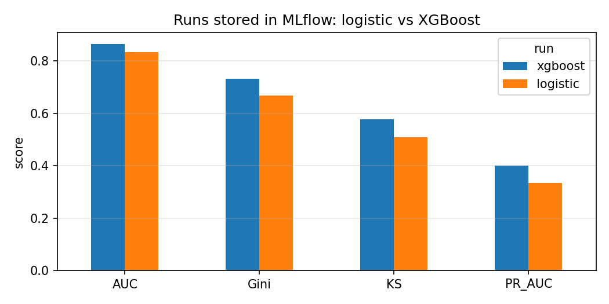

# Explainable Credit Risk Scoring

A credit default risk model that predicts whether an applicant will experience serious financial distress within two years - and, more importantly, **explains why** each decision was made, in plain Turkish.

Turkish: [README.tr.md](README.tr.md)



## Why this repo exists

A model that outputs a default probability is only half of what a bank actually needs. In a regulated environment, a rejected applicant has the right to know *why*, and a risk team has to be able to audit the model's reasoning. So this project pairs a standard credit-scoring model with an explainability layer: classic **Information Value (IV)** for feature selection, **SHAP** to break down each individual decision, and an **LLM** to turn that breakdown into a rationale a customer could actually read.

The data is the public [Give Me Some Credit](https://www.kaggle.com/c/GiveMeSomeCredit) dataset (150,000 applicants). No real customer data is used.

## What it does

The pipeline runs end to end: it audits and cleans the data, selects and validates features, trains and compares two models, explains their decisions, and writes a human-readable justification.

### 1. Data quality audit (not just cleaning)

`DebtRatio` (debt-to-income) should sit around 0–1, but the raw data reaches **329,664** — impossible. Instead of blindly clipping, the notebook investigates *why*: **94.9% of the highest-`DebtRatio` records have missing income**. The field breaks precisely where income is unknown. A statistical cap (99th percentile) was useless here (it landed at ~4,979 because most of the tail is corrupt), so `DebtRatio` is capped at a domain-sensible **2.0**, while `RevolvingUtilization` — whose 99th percentile is a reasonable ~1.09  is capped statistically. Two different problems, two different fixes.

This cleaning is not cosmetic: it lifted the baseline model's **KS from 0.457 to 0.509**.

### 2. IV feature selection, cross-checked with SHAP

Information Value is the classic credit-scoring measure of a feature's predictive power. IV ranks `RevolvingUtilization`, `30-59 days past due`, and `age` as strongest and the SHAP analysis agrees.


*Global SHAP importance of the XGBoost model: credit utilisation and payment history dominate, in line with the IV ranking.*

Where they *disagree* is instructive: the 90-day and 60-89-day delinquency counts score IV ≈ 0 despite SHAP finding them highly important, because these features are extremely zero-inflated and IV's simple binning can't measure them tree-based SHAP can. Features are not dropped (trees handle weak features fine); IV is used as an independent validation of what the model relies on.

### 3. Baseline → stronger model

An interpretable Logistic Regression baseline (`class_weight="balanced"`) is compared against XGBoost (`scale_pos_weight` for the ~14:1 imbalance). XGBoost wins, but cleaning narrowed the gap a reminder that data quality can matter more than model complexity.



| Model | AUC | Gini | KS | PR-AUC |
|-------|-----|------|----|--------|
| Logistic (before cleaning) | 0.802 | 0.604 | 0.457 | 0.323 |
| Logistic (after cleaning) | 0.834 | 0.668 | 0.509 | 0.335 |
| **XGBoost** | **0.866** | **0.732** | **0.577** | **0.401** |

### 4. SHAP + LLM: from a number to a sentence

XGBoost is powerful but opaque which is exactly why explainability isn't optional in banking. `TreeExplainer` breaks down each prediction into per-feature contributions (positive = raises risk). Those contributions are then handed to an LLM via Groq (`openai/gpt-oss-120b`), which produces a plain-Turkish rationale with no technical jargon. The first run used Llama-3.3-70B; Groq has since retired that model, so the notebook now uses gpt-oss-120b.

Example output for a high-risk applicant (default probability 0.99, with seven 90+ day delinquencies):

> *Başvurunuzda, geçmişte sık sık ve uzun süreli ödeme gecikmeleri yaşamanız ve mevcut aylık gelirinizin kredi geri ödemelerini karşılamakta yetersiz kalabileceği değerlendirilmiştir. Bu nedenle, şu anda kredi talebinizi olumlu sonuçlandıramıyoruz. Anlayışınız için teşekkür ederiz.*
>
> *(English: "In your application, it was assessed that you have had frequent and long payment delays in the past, and that your current monthly income may not be enough to cover the loan repayments. For this reason, we cannot approve your credit request at this time. Thank you for your understanding.")*

The rationale is grounded in the applicant's actual top SHAP factors, both the 90+ day delinquencies and the low income, not a generic template. An LLM uses slightly different words on each run (and the wording changed when the model changed), but it should always name the same factors. This chain **model (score) → SHAP (why) → LLM (readable reason)** is the point of the project.

### 5. Experiment tracking with MLflow

Both models are logged as separate MLflow runs with their parameters and metrics (AUC, Gini, KS, PR-AUC). The notebook then reads the runs back with `mlflow.search_runs()` and compares them, so the results above come straight from the tracking store.



| Run | Model | AUC | Gini | KS | PR-AUC |
|-----|-------|-----|------|----|--------|
| xgboost | XGBoost | 0.866 | 0.732 | 0.577 | 0.401 |
| logistic | LogisticRegression | 0.834 | 0.668 | 0.509 | 0.335 |

Re-running the notebook reproduced the same numbers, because every step uses a fixed seed.

## Evaluation metrics

Accuracy is deliberately not used (with ~6.7% defaults it is misleading). The project reports the metrics a credit risk team actually uses:

- **KS (Kolmogorov-Smirnov)** - separation between good and bad applicants; the classic scorecard metric.
- **Gini** (= 2×AUC − 1) - the AUC restated in banking terms.
- **PR-AUC** - the most honest metric under class imbalance (baseline = the default rate, ~0.067).
- **Recall** - share of true defaulters caught; missing one is expensive.

Threshold is treated as a business decision, not a fixed 0.50: the notebook shows the precision/recall trade-off across thresholds.

## Project structure

```
explainable-credit-risk/
├── credit_risk_scoring.ipynb  # Full pipeline, narrated in English
├── assets/
│   ├── pipeline.png
│   ├── model_comparison.png
│   ├── shap_importance.png     # Global SHAP importance
│   └── mlflow_runs.png         # Runs read back from MLflow
├── README.md
└── README.tr.md
```

## Setup and running

The notebook is built for Google Colab (no GPU needed; the LLM step uses a hosted API).

1. Download `cs-training.csv` from the [Give Me Some Credit](https://www.kaggle.com/c/GiveMeSomeCredit) data tab and upload it to the notebook.
2. In Colab, add `GROQ_API_KEY` under **Secrets** (with notebook access enabled) for the LLM step. Without a key, skip the two LLM cells; the rest of the notebook does not depend on them.
3. `Runtime → Run all`.

```bash
# If running locally instead:
pip install pandas numpy scikit-learn xgboost shap groq mlflow scipy matplotlib
```

## Tech stack

scikit-learn (Logistic Regression, scaling, split) · XGBoost · SHAP (TreeExplainer) · Groq / openai/gpt-oss-120b (Turkish rationale) · MLflow (experiment tracking and run comparison) · pandas / NumPy / SciPy · Matplotlib

## Known limitations

These are honest boundaries, documented rather than hidden:

- **DebtRatio cap (2.0) is a heuristic.** A production system would model the missing-income cases explicitly (e.g. a separate indicator) rather than clip.
- **IV binning is naive** on zero-inflated count features, which is why some delinquency counts score IV ≈ 0. Custom binning would fix this.
- **Single train/test split**, no cross-validation and no hyperparameter tuning - this is a clear baseline, not a tuned production model.
- **The LLM rationale is not a legal document.** It reflects the model's factors, not a bank's official adverse-action language, and would need review before customer-facing use.
