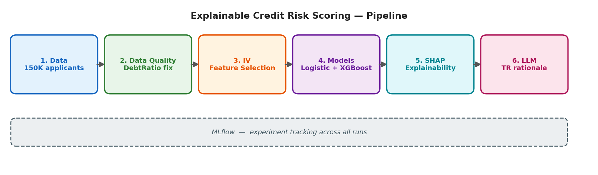
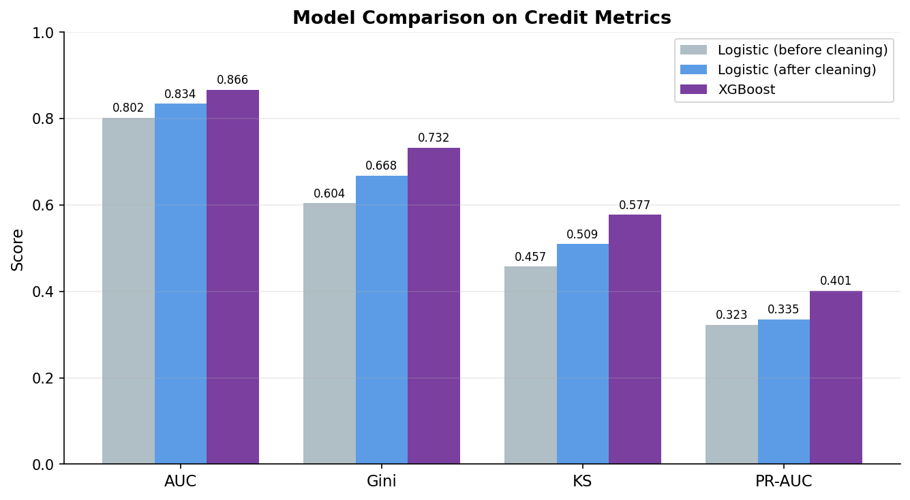

# Açıklanabilir Kredi Risk Skorlama

Bir başvuranın 2 yıl içinde ciddi ödeme sıkıntısına düşme olasılığını tahmin eden ve daha da önemlisi her kararın **neden** verildiğini sade Türkçe **açıklayan** bir kredi risk modeli.

English: [README.md](README.md)



## Bu repo neden var

Bir temerrüt olasılığı üreten model, bir bankanın gerçekte ihtiyaç duyduğu şeyin sadece yarısıdır. Regüle bir ortamda reddedilen başvuranın *nedenini* bilme hakkı vardır ve risk ekibinin modelin gerekçesini denetleyebilmesi gerekir. Bu proje standart bir kredi skorlama modelini bir açıklanabilirlik katmanıyla birleştiriyor: feature selection için klasik **Information Value (IV)**, her kararı parçalamak için **SHAP**, ve bu parçalamayı bir müşterinin okuyabileceği gerekçeye çevirmek için bir **LLM**.

Veri, herkese açık [Give Me Some Credit](https://www.kaggle.com/c/GiveMeSomeCredit) veri setidir (150.000 başvuran). Gerçek müşteri verisi kullanılmamıştır.

## Ne yapıyor

Boru hattı uçtan uca çalışır: veriyi denetler ve temizler, özellikleri seçer ve doğrular, iki modeli eğitip karşılaştırır, kararlarını açıklar ve insan tarafından okunabilir bir gerekçe yazar.

### 1. Veri kalitesi denetimi (sadece temizlik değil)

`DebtRatio` (borç/gelir oranı) mantıken 0–1 civarı olmalı, ama ham veri **329.664**'e ulaşıyor - imkansız. Körlemesine kırpmak yerine notebook *nedenini* araştırıyor: **en yüksek DebtRatio'lu kayıtların %94.9'unun geliri eksik.** Alan tam olarak gelirin bilinmediği yerde bozuluyor. İstatistiksel eşik (%99'luk) burada işe yaramadı (~4.979 çıktı, çünkü kuyruğun çoğu bozuk), bu yüzden `DebtRatio` domain mantığıyla **2.0**'a kırpıldı; `RevolvingUtilization` ise — %99'luk değeri makul (~1.09) olduğu için istatistiksel olarak kırpıldı. İki farklı sorun, iki farklı çözüm.

Bu temizlik kozmetik değil: baseline modelin **KS'ini 0.457'den 0.509'a** çıkardı.

### 2. IV ile feature selection, SHAP ile çapraz doğrulama

Information Value, bir özelliğin tahmin gücünü ölçen klasik kredi skorlama metriğidir. IV en güçlü olarak `RevolvingUtilization`, `30-59 gün gecikme` ve `age`'i sıralıyor - SHAP analizi de aynı fikirde. *Ayrıştıkları* nokta öğretici: 90 gün ve 60-89 gün gecikme sayaçları, SHAP onları çok önemli bulmasına rağmen IV ≈ 0 alıyor; çünkü bu özellikler aşırı sıfır-ağırlıklı ve IV'nin basit binning'i onları ölçemiyor ağaç tabanlı SHAP ölçebiliyor. Özellikler silinmiyor (ağaç modelleri zayıf özellikleri idare eder); IV, modelin neye dayandığının bağımsız bir doğrulaması olarak kullanılıyor.

### 3. Baseline → daha güçlü model

Açıklanabilir bir Logistic Regression baseline (`class_weight="balanced"`), XGBoost (~14:1 dengesizlik için `scale_pos_weight`) ile karşılaştırılıyor. XGBoost kazanıyor ama temizlik aradaki farkı daralttı veri kalitesinin bazen model karmaşıklığından daha önemli olduğunun hatırlatması.



| Model | AUC | Gini | KS | PR-AUC |
|-------|-----|------|----|--------|
| Logistic (temizlik öncesi) | 0.802 | 0.604 | 0.457 | 0.323 |
| Logistic (temizlik sonrası) | 0.834 | 0.668 | 0.509 | 0.335 |
| **XGBoost** | **0.866** | **0.732** | **0.577** | **0.401** |

### 4. SHAP + LLM: bir sayıdan bir cümleye

XGBoost güçlü ama opak bankada açıklanabilirliğin neden opsiyonel olmadığının sebebi tam da bu. `TreeExplainer` her tahmini özellik-bazlı katkılara ayırıyor (pozitif = riski artırır). Bu katkılar sonra Llama-3.3'e (Groq üzerinden) veriliyor ve teknik terim içermeyen, sade Türkçe bir gerekçe üretiliyor.

Yüksek riskli bir başvuran için örnek çıktı (temerrüt olasılığı 0.99, yedi kez 90+ gün gecikme):

> *Başvurunuzun değerlendirilmesi sırasında, geçmiş ödeme performansınızın beklentilerin altında olduğu görüldü. Özellikle son dönemde yaşanan 90+ gün ödeme gecikmeleri, kredi alma kararını olumsuz etkileyen önemli bir faktör oldu. Aylık geliriniz de kredi geri ödeme kapasitenizi tam olarak karşılamıyor gibi görünüyor.*

Gerekçe, başvuranın gerçek en güçlü SHAP faktörlerine dayanıyor hem 90+ gün gecikmeler hem düşük gelir - jenerik bir şablona değil. Bu zincir — **model (skor) → SHAP (neden) → LLM (okunabilir gerekçe)** - projenin asıl amacıdır.

## Değerlendirme metrikleri

Accuracy bilerek kullanılmıyor (~%6.7 temerrütle yanıltıcı olur). Proje, bir kredi risk ekibinin fiilen kullandığı metrikleri raporluyor:

- **KS (Kolmogorov-Smirnov)** - iyi ve kötü başvuranların ayrışması; klasik scorecard metriği.
- **Gini** (= 2×AUC − 1) - AUC'nin banka dilindeki hali.
- **PR-AUC** - dengesiz veride en dürüst metrik (taban = temerrüt oranı, ~0.067).
- **Recall** - yakalanan gerçek temerrütçülerin oranı; birini kaçırmak pahalı.

Threshold sabit 0.50 değil, bir iş kararı olarak ele alınıyor: notebook, eşikler boyunca precision/recall dengesini gösteriyor.

## Proje yapısı

```
explainable-credit-risk/
├── kredi_risk_skorlama.ipynb   # Markdown anlatılı tam boru hattı
├──  pipeline.png
├── model_comparison.png
├── README.md
└── README.tr.md
```

## Kurulum ve çalıştırma

Notebook Google Colab için hazırlandı (GPU gerekmez; LLM adımı hosted API kullanır).

1. `cs-training.csv`'yi [Give Me Some Credit](https://www.kaggle.com/c/GiveMeSomeCredit) veri sekmesinden indirip notebook'a yükle.
2. Colab'da LLM adımı için **Secrets**'a `GROQ_API_KEY` ekle (notebook erişimi açık olmalı).
3. `Runtime → Run all`.

```bash
# Lokalde çalıştıracaksan:
pip install pandas numpy scikit-learn xgboost shap groq mlflow scipy matplotlib
```

## Teknik 

scikit-learn (Logistic Regression, ölçekleme, split) · XGBoost · SHAP (TreeExplainer) · Groq / Llama-3.3-70b (Türkçe gerekçe) · MLflow (deney takibi) · pandas / NumPy / SciPy · Matplotlib

## Bilinen sınırlar


- **DebtRatio kırpması (2.0) bir sezgisel yöntem.** Production sistemi, gelir-eksik vakaları kırpmak yerine açıkça modellerdi (ör. ayrı bir gösterge).
- **IV binning**, sıfır-ağırlıklı sayaç özelliklerinde naif; bazı gecikme sayaçlarının IV ≈ 0 almasının sebebi bu. Özel binning bunu düzeltir.
- **Tek train/test split**, cross-validation ve hiperparametre optimizasyonu yok - bu net bir baseline, tune edilmiş bir production modeli değil.
- **LLM gerekçesi hukuki bir belge değil.** Modelin faktörlerini yansıtır, bir bankanın resmi red dilini değil; müşteriye gösterilmeden önce inceleme gerekir.
